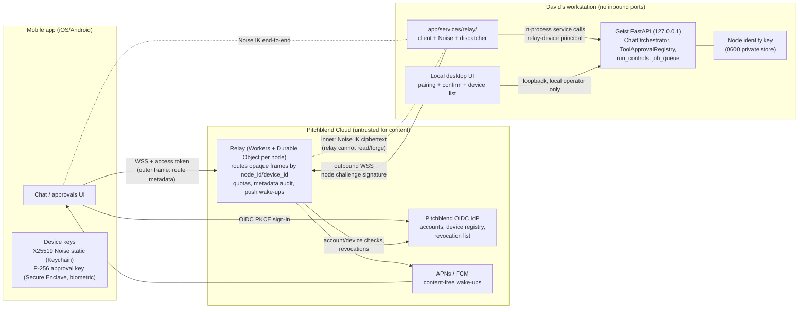

# Secure Mobile Relay for Remote Geist Control

## Objective

Let a lightweight mobile app, signed in with a Pitchblend account, start and
steer Geist agent runs on David's own workstations (approve tool calls, stop
runs, read chats) while:

- every Geist node stays bound to loopback and opens **no inbound port**;
- the relay can route traffic but **cannot read, forge, reorder, or replay**
  commands or results;
- a tool call still runs only after **an explicit, cryptographically signed user
  confirmation** of that exact call, and the highest-risk tools stay local-only
  until a step-up path is proven.

This is a design document only. It does not change feature code. It extends
the "future multi-node control" section of
`plans/164-WORKSPACE-PRINCIPAL-MULTI-NODE.md` and the trust-boundary notes in
`docs/CHAT_TOOL_REGISTRY.md` ("Security and identity model"), and replaces
their Tailscale-only assumption with a product path that does not require a VPN
client on the phone.

## Assumptions

1. **Pitchblend** in this repository refers to two things. The first is the
   GitHub App review gate (`.github/workflows/pitchblend-review.yml`,
   `.github/scripts/pitchblend_review.py`, `plans/155-PITCHBLEND-LOW-RISK-REVIEW.md`),
   which is unrelated to runtime. The second is the Pitchblend desktop product:
   an Electron wrapper that launches Geist with a per-launch
   `GEIST_OPERATOR_TOKEN` (authenticated as subject `pitchblend-managed` in
   `app/security/operator.py`) plus **Pitchblend Cloud**, whose OIDC login
   handles account, licensing, and memory sync (`plans/163-NEUTRAL-DEFAULT-WORKSPACE.md`,
   `docs/CHAT_TOOL_REGISTRY.md`). A "Pitchblend account" is therefore an OIDC
   identity issued by an identity provider David controls. He can add
   endpoints to it (device registration, node registry, revocation).
2. Pitchblend Cloud and the relay are operated by David but are treated as
   **honest-but-breachable**. They are trusted for availability, routing, and
   coarse account decisions. They are not trusted for command confidentiality,
   integrity, or authorization on a node.
3. One human controls each Geist node. Geist keeps its singleton workspace
   (`get_default_workspace()`), and a Pitchblend identity is never mapped into
   the Geist database (invariant from plan 164).
4. Phones are modern iOS/Android devices with a hardware keystore (Secure
   Enclave / StrongBox) that supports non-exportable **P-256** keys gated by
   biometrics. Neither supports Ed25519 or X25519 in hardware.
5. Expected scale is personal first (David: a few nodes, one or two phones),
   then a modest Pitchblend customer base (hundreds to low thousands of nodes).
6. Geist nodes are macOS or Linux for the MVP. Windows key storage is deferred,
   matching the current limitation of the credential store in PR #370.

## Current Architecture (what the relay must respect)

### Exposure and binding

- Packaged CLI: `app/cli.py` defaults to `127.0.0.1`, refuses a non-loopback
  `--host` without `--allow-remote`, and installs `LoopbackSecurityMiddleware`
  (`app/loopback_security.py`) when loopback-only. That middleware rejects
  non-loopback `Host` headers, which defends against DNS rebinding, and
  cross-origin `Origin` headers on unsafe methods and WebSockets.
- Docker: `docker-compose.yml` publishes UI 3000, API 5001, and the debugger
  5678 on `127.0.0.1` only.
- Native dev: `bootstrap.py` and the `app/main.py` `__main__` block bind
  `0.0.0.0`. They rely on operator-token authentication rather than binding.
  The relay must not depend on this. It connects outbound and never needs an
  inbound listener.

### Authentication and authorization

- `OperatorAuthenticationMiddleware` (`app/security/middleware.py`) requires a
  principal on every HTTP/WebSocket request except health and docs.
- `app/security/operator.py` defines pluggable `OperatorAuthenticator`s
  (`ConfiguredTokenAuthenticator` for the token file or wrapper token, and
  `LoopbackAuthenticator`). It builds an immutable `OperatorPrincipal` with
  `capabilities` (`workspace.read|write`, `tools.manage|execute`) and **already
  reserved fields** `controller_node_id`, `target_node_id`, `audience`,
  `expires_at`, `credential_id` for exactly this kind of remote principal.
- `is_local_operator` already gates process-spawning configuration: stdio MCP
  servers can only be configured by a local principal
  (`app/api/v1/endpoints/mcp.py`, `allow_stdio=operator.is_local_operator`).
- The token is injected server-side by the dev proxy
  (`client/geist/src/setupProxy.js`) or the Electron session. It never reaches
  page JavaScript.
- Several legacy routes (`/agent/chat_history/*`, `/agent/chat_sessions*`) only
  get the global authentication check, with no per-route capability. A remote
  dispatcher must enforce its own per-operation capability check instead of
  relying on route dependencies.

### Chat/agent streaming

- `POST /agent/complete_text_stream[/{session_id}]` returns SSE from
  `async_stream_chat_completion` (`app/main.py`). Event names come from
  `ChatOrchestrator.stream` (`app/services/chat_orchestrator.py`): `run_started`,
  `chat_id`, `delta`, `tool_call` (statuses include `proposed`,
  `awaiting_approval`, `cancelled`, results), `artifact`, `plan`, `goal`,
  `user_instruction`, `final`, `error`, `cancelled`, `done`. `approval_wait` is
  turned into an SSE comment keepalive.
- **The run is bound to the HTTP connection.** When the client disconnects, the
  `finally` block calls `run_controls.cancel(...)`. That is correct for a
  browser tab but wrong for a phone that drops off LTE for 3 seconds.
- Run control: `POST /agent/runs/{run_id}/cancel`,
  `POST /agent/runs/{run_id}/instructions` (mid-run steering, idempotent by
  `instruction_id`), and `POST /agent/runs/{run_id}/tool_approval`. All three
  require `tools.execute`.

### Tool approval

- `ToolApprovalRegistry` (`app/services/tool_approvals.py`) holds in-memory
  pending approvals keyed by `(run_id, call_id)`. Each records the
  `arguments_fingerprint` (SHA-256 of canonical name+args) and
  `definition_fingerprint` (includes the MCP config revision). Pending approvals
  expire after 300 s, settle atomically, and fail closed.
- `resolve()` accepts `approve | session | always | deny` but **does not take an
  expected arguments fingerprint**. The UI is trusted to have shown the right
  call. A remote approver needs that binding to be explicit.
- `tool_requires_approval` (`agents/models/tool_calling.py`) lets the
  workspace's `auto_approve` mode waive approval for everything except
  `requires_per_call_approval` tools. `terminal.run` (side effect `process`) and
  `workspace.write_file` / `workspace.edit_file` (`filesystem_write`) use
  per-call approval by default (`app/services/tool_registry.py`). MCP tools are
  `external_write`.
- Unattended callers (`interactive=False`, used by routines through
  `run_routine`) deny approval-gated tools immediately
  (`UNATTENDED_DENY_MESSAGE`).

### Background jobs

- `app/services/job_queue.py` runs a durable DB queue (`job` table, a
  single-claim worker, backoff, `dedupe_key`, `recover_stale_jobs` lease).
  `app/services/routine_scheduler.py` runs routines unattended.
- PR #350 adds `prompt_schedule` and `prompt_schedule_run`, a separate inference
  worker lane, and run-history rows keyed by scheduled time. It uses
  `complete_text` without tools, so it has no approval interaction.

### MCP trust boundaries and credentials

- MCP tool output is untrusted third-party content (`docs/CHAT_TOOL_REGISTRY.md`).
  The client blocks redirects and credential URLs, caps sizes, and declines
  server-initiated requests.
- PR #316 adds `app/services/mcp_security.py`: a fail-closed LLM inspector for
  untrusted MCP payloads, `McpWritePolicy` (recipient tracking for write tools),
  a `BlockedOriginalStore`, and an append-only hash-only JSONL
  `SecurityAuditLog` at `default_data_dir()/security-audit.log`.
- Credentials today: provider API keys come from the environment / `.env`
  (`load_environment_dictionary`). MCP `env` and `headers` are plaintext JSON
  columns in `mcp_server`. PR #370 adds `app/services/mcp_oauth_store.py`:
  private `0600` files under `default_data_dir()/mcp-credentials/` (directory
  `0700`, owner-checked, `O_NOFOLLOW`, atomic `os.replace`, `flock` locks,
  macOS/Linux only), plus PKCE S256 and single-use hashed `state` with an
  HttpOnly browser cookie in `app/services/mcp_oauth.py`. Nothing is encrypted
  at rest, and there is no OS keychain integration.
- No cryptography library is in `uv.lock` today (only `cffi`, transitively).

### Reusable pieces from open PRs

| PR | Reuse for the relay |
| --- | --- |
| #350 scheduled prompts | `dedupe_key` enqueue semantics and run-history rows. This is the pattern for durable "deferred prompt" jobs in phase 3. Its separate inference lane prevents a mobile-triggered run from starving tool/workflow jobs. |
| #370 OAuth MCP | Generalize `mcp_oauth_store.py` into a private-file secret store for the node identity key. Reuse its PKCE/state hygiene for the standalone node-enrollment flow, and copy its callback middleware exemption pattern (narrow, single-use, state-validated). |
| #316 MCP inspection | `SecurityAuditLog` format (hashes, never bodies) for the relay audit log. Treat inspector verdicts as an input to mobile risk badges. `McpWritePolicy` recipient checks still apply to mobile-approved calls. |
| #381 reasoning continuations | Persists provider reasoning state in transcripts and goal checkpoints, so a run paused on an approval can continue correctly when the approval arrives minutes later from a phone. This is a prerequisite for long remote approval waits on reasoning models. |
| #376 live voice tools | Precedent: delegation reuses the authenticated chat stream, the registry, and approvals, and "spoken consent does not replace" UI approval. The relay applies the same rule: a mobile prompt never implies approval. |

## Threat Model

Assets: the ability to execute tools on the node (shell, filesystem, MCP
writes); chat and memory contents; provider and MCP credentials on the node;
the integrity of approvals.

| Threat | Example | Primary mitigations |
| --- | --- | --- |
| **Compromised relay / Pitchblend Cloud** | An attacker with relay root injects `chat.send "rm -rf ~"` or approves a pending call, reads chats, or silently adds their own phone to David's account. | End-to-end Noise sessions between the device and node keys. The relay sees only routing metadata. The node authorizes only devices in its **local** allowlist, written by a local pairing ceremony that the cloud cannot perform. Cloud can only *reduce* privileges (revoke, block routing). Approvals carry a hardware-key signature the relay cannot produce. |
| **Stolen or unlocked phone** | A thief with an unlocked phone opens the app. | App-level biometric/passcode unlock (short idle lock). Every approval requires a biometric-gated Secure Enclave signature. Process-class tools are local-only in the MVP. Remote revocation from any other enrolled device, the Pitchblend web account, or the desktop. Per-device rate limits. Device keys are non-exportable, so a stolen backup cannot clone a device. |
| **Stolen Pitchblend credentials** | A phished password or refresh token. | The account alone grants nothing on a node. Pairing needs physical access to the desktop UI (QR + local confirm). Refresh tokens are device-bound (DPoP-style proof with the device key). Account changes trigger a notification. |
| **MITM / TLS interception** | Corporate proxy, malicious Wi-Fi, mis-issued certificate. | TLS is transport only. Noise IK authenticates both static keys learned at pairing, so a MITM ends up in the same position as a compromised relay. Pairing uses Noise XXpsk3 with a QR-delivered 128-bit secret, so the relay cannot MITM key exchange. |
| **Replay / reordering** | Re-send a captured "approve" or `chat.send`, or reorder cancel and approve. | Noise transport nonces (strictly increasing; out-of-order or duplicate frames fail decryption). Request ULIDs are deduplicated on the node for 24 h with a ±5 min timestamp window. Approval signatures bind `run_id`, `call_id`, `arguments_fingerprint`, `definition_fingerprint`, `node_id`, and pending expiry, and they are single-use. |
| **Prompt injection via relay** | The relay or a third party smuggles instructions into prompts or results. | The relay cannot modify ciphertext. Remaining injection comes from tool/MCP output, which is already untrusted. The mobile approval UI renders the exact tool name and canonical arguments from the node (never a model-written summary) plus side-effect class and inspector verdict (#316). A model cannot approve its own calls. |
| **Malicious or unintended commands** | A legitimate device sends a dangerous request, or the model proposes one. | Mobile operations are an explicit allowlist (no settings, MCP, plugin, model, or permission edits). A permission floor for relay-origin runs ignores workspace `auto_approve`. `session` and `always` standing grants cannot be issued from mobile. Process tools need desktop approval. |
| **Malicious node / node impersonation** | An attacker registers a fake node to phish prompts. | The device pins the node static key from the pairing QR. The relay's node registry is only a hint. |
| **Denial of service** | Flooding a node through the relay, or relay outage. | Relay quotas per account, device, and node. The node drops excess before decryption cost (pre-check route and size), and its own per-device budgets. Local Geist is unaffected by relay outage. |
| **Metadata leakage** | Relay learns when David uses Geist, node names, and sizes. | Accepted for the MVP. Node display names are encrypted for devices, and the relay sees only opaque IDs. Optional padding/coalescing of deltas. Revisit if needed. |

Out of scope: a fully compromised node OS (it already holds every credential),
a compromised mobile OS/hardware keystore, and a malicious local operator.

## Recommended Topology

**Recommendation:** a dumb, stateless-for-content WebSocket relay operated by
Pitchblend (Cloudflare Workers + one Durable Object per node). Every Geist node
keeps one outbound WSS connection to it, and devices connect outbound too. A
**Noise** session per (device, node) pair carries all application messages.
Geist talks to the relay from a new in-process module and dispatches an
allowlisted set of operations to existing services. It does not proxy arbitrary
HTTP.



Why this over the alternatives:

- **Port forwarding / public Geist**: rejected. It breaks the loopback invariant
  and turns every Geist route into internet attack surface.
- **Tailscale / WireGuard mesh** (the plan 164 idea): excellent for David
  personally and a fine stopgap. It requires a VPN client and tailnet admin on
  every phone, does not use the Pitchblend account, and still needs app-level
  authorization because Tailscale is "defense in depth". Keep it as a
  documented power-user alternative, not the product path.
- **Generic tunnel (Cloudflare Tunnel / ngrok) to the Geist HTTP API**: rejected.
  It exposes the full API surface, and TLS terminates at the tunnel provider, so
  that provider can read and forge everything.
- **Relay proxying arbitrary HTTP inside E2E**: rejected for the MVP. It is
  simpler to build but grants the phone the whole API (settings, MCP stdio
  config, permission mode). An explicit operation allowlist is the
  authorization boundary.

## Identity, Enrollment, and Pairing

### Keys

| Key | Holder | Algorithm | Storage | Purpose |
| --- | --- | --- | --- | --- |
| Node identity | Geist node | X25519 (Noise static) + Ed25519 (relay auth) | `default_data_dir()/relay/` private `0600` files via a store generalized from `mcp_oauth_store.py`; keychain later | Noise responder identity; signs relay connect challenges |
| Device Noise static | Phone | X25519 | Keychain / Android Keystore-wrapped, non-syncing (`ThisDeviceOnly`) | Noise initiator identity |
| Device approval key | Phone | P-256 ECDSA | Secure Enclave / StrongBox, non-exportable, biometric (`.userPresence` / `setUserAuthenticationRequired`) | Signs approvals and sensitive commands; step-up |
| Pitchblend tokens | Phone | OIDC access/refresh | Keychain | Authenticates the human to the relay for routing only |

Two device keys exist because hardware keystores only offer P-256, while Noise
and the libsodium ecosystem use 25519. The Noise key protects the channel. The
hardware key proves "the enrolled phone's owner just confirmed this exact
action", and a stolen software key alone cannot produce that.

### Node enrollment (node to Pitchblend account)

1. The local operator opens **Settings → Mobile access → Enable** in Geist (a
   local-only route, see Integration).
2. Geist generates the node identity keys and a random `node_id` (128-bit,
   base32).
3. The node is bound to the account:
   - **Pitchblend-managed**: the Electron wrapper, already signed in with OIDC,
     calls Pitchblend Cloud `POST /nodes` with the node public keys and receives
     a node registration. The wrapper hands only the registration result (not
     OIDC tokens) to Geist over the existing operator-token channel.
   - **Standalone Geist**: OAuth 2.0 Device Authorization Grant (RFC 8628). Geist
     shows a user code, David approves it on pitchblend.example/activate, and
     Geist receives a one-time registration grant. This uses PKCE/state hygiene
     like `app/services/mcp_oauth.py` (#370), but no loopback callback is
     needed.
4. The relay authenticates the node on every connect with a challenge signed by
   the node Ed25519 key (no long-lived bearer secret on disk) and issues a
   1-hour relay session.

### Device pairing (phone to node), the trust anchor

Pairing requires physical/local access to the desktop. Pitchblend Cloud cannot
pair a device.

1. Phone: David signs in with Pitchblend (OIDC + PKCE through
   `ASWebAuthenticationSession` / Custom Tabs). The phone generates both device
   keys.
2. Desktop: **Pair a phone** calls `POST /api/v1/relay/pairings` (local
   operator only). The node creates a pairing record: 128-bit `pairing_secret`,
   5-minute TTL, single-use. The UI renders a QR containing
   `{v, relay_url, node_id, node_static_pub, pairing_id, pairing_secret}`.
3. Phone scans the QR. Over the relay it runs **Noise XXpsk3** with
   `psk = HKDF(pairing_secret)`. Both static keys are exchanged and mutually
   authenticated by the PSK, so a relay MITM fails. Inside, the phone sends its
   P-256 approval public key, a device display name, its Pitchblend `sub`, and
   an optional App Attest / Play Integrity token.
4. Desktop shows "Pair **David's iPhone**? Safety code `TIGER-OCEAN-42`" (derived
   from the handshake hash, also shown on the phone). David confirms
   locally. The node writes a `relay_device` row with granted capabilities.
5. The node tells Pitchblend Cloud (signed with the node key) that device D may
   route to node N, so the relay will accept the route. The cloud registry is
   **necessary for routing but never sufficient**: the node always checks its
   own allowlist.

Re-pairing is required after revocation, app reinstall, or key loss. iCloud or
Google backup never restores device keys.

### Token lifetimes

| Credential | Lifetime | Notes |
| --- | --- | --- |
| Pairing secret | 5 min, single-use | Destroyed on success, failure, or expiry |
| Pitchblend access token (phone to relay) | 10 min | Audience `relay`; carries `sub`, device id |
| Pitchblend refresh token | 30 days sliding, rotating | Device-bound proof of possession (DPoP with device key); reuse detection revokes the family |
| Relay node session | 1 h | Renewed by a fresh challenge signature |
| Noise session | Per WebSocket connection; rekey every 1 h or 2^20 messages | Forward secrecy per session |
| Approval signature | Valid until the pending approval's `expires_at` (≤ 300 s, current default) and single-use | Covers the full approval tuple |
| Device enrollment | No hard expiry; considered **stale after 30 days unseen** and then needs a desktop re-confirm | Shown in the device list with last-seen |
| App unlock | Biometric on open; relock after 5 min in background | Separate from approval biometric |

### Revocation

- **Local (authoritative, immediate)**: Settings → Mobile access → Remove
  device, or a **Disable remote access** kill switch that stops the relay client
  and rejects all relay principals.
- **From Pitchblend account / another device ("lost phone")**: the cloud marks
  the device revoked, the relay drops its routes and live sessions, and it sends
  a revocation notice signed by the cloud to the node. Nodes **accept
  revocations from the cloud without local confirmation** because a revocation
  can only reduce privilege. An enrolled sibling device can also sign a
  revocation with its approval key, which the node verifies directly.
- **Node revocation**: removing the node from the account stops routing. Locally
  disabling deletes node keys after confirmation.
- The node rechecks `relay_device.revoked_at` on every inbound message (an
  in-memory cache invalidated on write), not just at handshake.

## End-to-End Encryption

### Options compared

| Option | Relay can read? | Relay can forge? | Mutual auth | Forward secrecy | Replay/order | Effort / risk |
| --- | --- | --- | --- | --- | --- | --- |
| TLS only (to relay) | Yes | Yes | No (relay terminates) | Per hop | Per hop | Trivial, unacceptable for our threat model |
| TLS + app JWT signed by Pitchblend | Yes | Yes, if cloud is compromised | Cloud-mediated | Per hop | Token-level only | Low; still trusts the cloud |
| libsodium `crypto_box_seal` per message + Ed25519 signature | No | No | Via signatures (sealed boxes alone are anonymous) | **No** | Must build counters | Low/medium; easy to misuse; key compromise exposes all history |
| HPKE (RFC 9180) per message + signatures | No | No | Via auth mode/signatures | Per message to static key only | Must build | Medium; less mobile library maturity |
| **Noise IK (+ XXpsk3 for pairing)** | **No** | **No** | **Yes (static keys)** | **Yes (ephemeral per session)** | **Built in (nonces)** | Medium; small spec with official test vectors; a session layer we need anyway |
| Signal double ratchet / MLS | No | No | Yes | Per message, post-compromise security | Built in | High; excessive for 1 human ↔ N own nodes |

### Recommendation

- **Handshake**: `Noise_IK_25519_ChaChaPoly_BLAKE2s`. The phone (initiator)
  already knows the node static key from pairing, so IK gives a one-round-trip
  handshake that encrypts the initiator's identity. Use
  `Noise_XXpsk3_25519_ChaChaPoly_BLAKE2s` for pairing only. The Noise
  prologue binds `"geist-relay/1" || node_id || device_id`, so a session cannot
  be spliced onto another route.
- **Transport**: Noise transport messages inside relay WebSocket binary frames.
  The 64-bit Noise nonce gives strict in-session ordering and replay rejection.
  A lost or reordered frame breaks the session by design, and the client
  reconnects and resumes at the application layer (see Protocol).
- **Application signatures on top** for approvals and other sensitive commands:
  P-256 ECDSA from the hardware key over a canonical, domain-separated payload.
  Noise proves "this enrolled device's software sent it". The signature proves
  "the human just confirmed it with biometrics".
- **Python implementation**: add **one** dependency, PyCA `cryptography`
  (X25519, Ed25519, ChaCha20-Poly1305, BLAKE2s/HKDF, and P-256 ECDSA verify).
  The standard library cannot do X25519 or AEAD, so a minimal inline
  implementation is not an option. Implement the Noise state machine in a small
  `app/services/relay/noise.py` (~300 lines) validated against the official
  cacophony/snow test vectors. Avoid the unmaintained `noiseprotocol` package.
  Follow AGENTS.md: `uv add cryptography==<pinned>` and run a dependency audit.
- **Mobile**: iOS CryptoKit provides Curve25519, ChaChaPoly, and HKDF natively
  (BLAKE2s through a vetted small library, or use the `SHA256` Noise variant on
  both sides if that is simpler; decide in phase 0). Android uses Tink or
  libsodium. The relay never sees keys or plaintext.

## Message Protocol

### Layers

1. **Outer frame (relay-visible, JSON or CBOR)**:
   `{v:1, kind: "hs"|"data"|"ctrl", node_id, device_id, conn_id, len}` plus an
   opaque `body` (base64 or binary). `ctrl` frames are relay ↔ endpoint only
   (`node_offline`, `quota_exceeded`, `revoked`, `ping`). The relay enforces a
   size limit (64 KiB per frame) and quotas, and never parses `body`.
2. **Inner message (Noise plaintext, JSON, schema-versioned with Pydantic in
   `app/services/relay/protocol.py`)**:

```json
{"t": "req", "id": "01J9Z...ULID", "ts": 1760214000, "op": "chat.send",
 "args": {"chat_id": 42, "prompt": "Summarize today's notes"},
 "sig": null}
{"t": "res", "re": "01J9Z...", "ok": true, "result": {"run_id": "r_123", "stream": "s_7"}}
{"t": "evt", "stream": "s_7", "seq": 18, "run_id": "r_123",
 "event": "tool_call", "payload": {"call_id": "c_4", "status": "awaiting_approval", "...": "..."}}
```

### Operations (allowlist) and mapping to existing code

| Op | Capability | Existing implementation reused | Notes |
| --- | --- | --- | --- |
| `node.status` | read | `/api/v1/system`, `_readiness_payload` | Version, model, busy state |
| `chats.list` | read | `get_paginated_chat_sessions` (`/agent/chat_sessions/paginated`) | |
| `chats.history` | read | `get_paginated_chat_history` (`/agent/chat_history/{id}/paginated`) | |
| `tools.catalog` | read | `/agent/tools` builder | Read-only, for rendering approvals |
| `chat.send` | execute | `stream_chat_events` / `async_stream_chat_completion` (`/agent/complete_text_stream[/{session_id}]`) | Model/agent settings stay node-side; `agentic_mode` allowed |
| `run.subscribe` | read | New run event buffer (below) | `from_seq` resume |
| `run.cancel` | execute | `run_controls.cancel` (`/agent/runs/{id}/cancel`) | |
| `run.instruct` | execute | `run_controls.enqueue` (`/agent/runs/{id}/instructions`) | `instruction_id` = request ULID |
| `run.approve` | execute + **signed** | `approval_registry.resolve` (`/agent/runs/{id}/tool_approval`) | `approve` or `deny` only; fingerprint-bound |
| `routines.list` / `routine.run_now` | read / execute | `/api/v1/routines`, `schedule_routine_once` | Phase 2 |
| `jobs.list` / `jobs.get` | read | `/api/v1/jobs` | Phase 2 |
| `device.revoke_self` / `device.revoke_sibling` | **signed** | `relay_device` | Kill switch |

**Never available through the relay**: MCP server CRUD/test/enable
(`/api/v1/mcp/*`, including OAuth connect), plugins, user settings and
`agent_permissions`, model downloads/selection, files upload/delete (until
phase 3), memory edit/delete, workflows edit, voice, routine create/edit, relay
pairing/device management, and any future `tools.manage` route.

### Streaming, ordering, and resume

- Today a run dies with its SSE connection. Add a **run event buffer**
  (`app/services/relay/run_streams.py`, later reusable by the web UI). It
  consumes `ChatOrchestrator.stream` in a background task for relay-origin runs
  and appends each event with a per-run monotonically increasing `seq` to a
  bounded ring (for example 2,000 events / 4 MiB). Subscribers (zero or more
  devices) read from it.
- **Detach policy**: when no device is subscribed, a relay-origin run keeps
  going. Pending approvals still time out by the existing 300 s rule (no change
  to `ToolApprovalRegistry` semantics). A run with no subscriber for 30 minutes
  is cancelled. Completed runs remain readable through `chats.history`, since
  transcripts are already persisted.
- **Resume**: after reconnect and a new Noise handshake, the phone sends
  `run.subscribe {run_id, from_seq}`. The node replays from the ring, or replies
  `{gap: true}` and the phone reloads `chats.history`.
- **Coalescing**: `delta` events are batched every ~100 ms or 2 KiB per frame.
  This cuts relay message counts (cost) by about 10× and reduces timing
  leakage.
- **Ordering**: one Noise session is strictly ordered. Across reconnects, `seq`
  orders events and request ULIDs order commands. Commands for one run are
  processed serially on the node.

### Idempotency and replay

- Every `req.id` is a ULID. The node stores `(device_id, id)` in `relay_request`
  with the response hash for 24 h. A duplicate returns the stored response
  without re-executing. Timestamps outside ±5 min are rejected (the phone
  syncs from `node.status`).
- `chat.send` is idempotent per `id`: a retried send after a network drop
  attaches to the existing run instead of starting a second one.
- **Signed approval payload** (canonical JSON, sorted keys, domain separator):

```json
{"domain": "geist-relay/approval/v1", "node_id": "...", "device_id": "...",
 "run_id": "r_123", "call_id": "c_4", "tool_name": "workspace.write_file",
 "arguments_fingerprint": "<sha256 from tool_arguments_fingerprint>",
 "definition_fingerprint": "<from approval_fingerprint()>",
 "decision": "approve", "pending_expires_at": 1760214300, "request_id": "01J9Z..."}
```

  The node verifies the signature with the enrolled P-256 key, compares both
  fingerprints with the live `PendingToolApproval`, and calls `resolve()`. A
  mismatch is a stale approval: the user must review again, matching the
  existing local contract.

## Authorization Model

- The relay dispatcher constructs an `OperatorPrincipal` with
  `authentication_method="relay-device"`, `is_loopback=False`,
  `subject="device:<device_id>"`, `credential_id=<device_id>`,
  `controller_node_id=<device_id>`, `target_node_id=<node_id>`,
  `audience="geist-node:<node_id>"`, `expires_at=<noise session expiry>`, and
  `capabilities` from the `relay_device` row (default
  `{workspace.read, tools.execute}`, never `tools.manage` or
  `workspace.write`). `is_local_operator` is therefore false, so the existing
  stdio-MCP guard already holds.
- **Relay-origin permission floor**: add `origin: Literal["local", "relay",
  "routine"]` to `ToolContext` (`agents/models/tool_calling.py`) and pass it from
  the dispatcher. In `tool_requires_approval`, relay-origin runs **ignore
  `auto_approve` and name-only `always_allow` grants for any tool whose
  `side_effect != "read"`**. Every write needs a fresh mobile approval even if
  the desktop is set to auto-approve.
- **Risk tiers for relay-origin calls:**

| Tier | Tools (today) | Mobile behavior |
| --- | --- | --- |
| Read | `workspace.read_file`, `workspace.search`, `documents.search`, `web.search`, `skills.load`, agent plan/goal tools | Existing policy (usually no approval) |
| Write | `workspace.write_file`, `workspace.edit_file`, `image.generate`, `mcp.*` from trusted servers | Per-call approval with biometric signature; full argument view; #316 inspector verdict shown |
| High | `terminal.run` (`process`), `mcp.*` on servers marked untrusted, email/SMS-style external sends | **Local-only in MVP**: the call stays `awaiting_approval`, the phone shows "Approve on your computer", and the desktop UI can approve within the timeout. Phase 3: optional per-node opt-in with step-up (a second biometric signature after a forced 5 s review of the full arguments) |

- **No standing grants from mobile**: `session` and `always` are rejected for
  relay principals (`ToolApprovalRegistry.resolve` receives the principal origin
  and refuses them). Mobile cannot change permission mode.
- A mobile prompt is user content, not approval (same rule as #376).
- Unattended paths are unchanged: routines and #350 schedules started via
  `routine.run_now` still run with `interactive=False` and deny gated tools.

## Rate Limiting and Audit

**Relay (coarse, protects infrastructure):**

- Per account: 10 concurrent device connections, 20 node connections.
- Per device: 20 frames/s (burst 60), 2 MiB/min upstream.
- Per node: 200 frames/s downstream (streaming), 20 MiB/min.
- Handshake failures: 10/min per device, then exponential backoff. 50
  failures/day flags the account.
- Metadata log only (timestamps, IDs, sizes, close codes), 30-day retention.

**Node (authoritative, protects the workstation):**

- Per device: 60 commands/min, 30 `chat.send`/hour, 3 concurrent relay-origin
  runs (2 per node total by default when local models are in use, since one GPU
  model serializes anyway).
- Payload limits: prompt ≤ 32 KiB, instruction ≤ 4 KiB.
- Any Noise decrypt failure or bad signature from an established session drops
  the session and increments a strike. 5 strikes in 10 min suspends the device
  until a local re-confirm, and the desktop shows an alert.

**Node audit log**: `default_data_dir()/relay-audit.log`, append-only JSONL in
the #316 `SecurityAuditLog` style (hashes, never prompt bodies or arguments).
Each record holds the previous record hash (hash chain) for tamper evidence.
Records: pairing started/confirmed/failed, device revoked (source), session
opened/closed, every op with `device_id`, `request_id`, `op`, result,
`prompt_sha256`/`arguments_fingerprint`, approval decisions with signature
verification result, and rate-limit/strike events. The desktop UI shows a
per-device activity view.

## Offline and Multi-Device Behavior

- **Node offline**: the relay answers `ctrl: node_offline` immediately with the
  last-seen time. In the MVP **commands are not queued** at the relay or
  anywhere else. A queued "delete the branch" executing hours later is a stale
  intent. Phase 3 may add **deferred prompts**: E2E-encrypted,
  signed, TTL ≤ 24 h, stored opaquely at the relay. On reconnect the node
  enqueues them via `job_queue` with `dedupe_key=request_id` (the #350 pattern)
  as read-only-tool runs unless the user approves later.
- **Phone offline**: runs continue (detach policy). Approvals time out and deny
  after 300 s as today. The phone gets a push wake-up; content-free by default
  ("Geist on *Studio* needs your approval"). Encrypted-payload pushes through a
  Notification Service Extension are a phase 2 option.
- **Multiple devices**: each device has its own Noise session, and the node
  fans out run events to every subscribed device. Approvals: the first valid
  signed decision wins (registry settlement is already atomic under its lock).
  Other devices receive `tool_call` with the resolved status. Desktop and phone
  can race safely the same way.
- **Multiple nodes**: the phone lists nodes from the relay registry (IDs plus
  encrypted display names) and keeps a Noise session per active node.
- **Relay outage**: local Geist is unaffected. The relay client reconnects with
  jittered exponential backoff (1 s → 5 min cap).

## Local Geist Integration

### New module `app/services/relay/`

| File | Responsibility |
| --- | --- |
| `identity.py` | Generate/load node keys; uses a generalized private store (`app/services/private_store.py`, extracted from #370's `mcp_oauth_store.py`) |
| `noise.py` | Noise IK / XXpsk3 handshake and transport on `cryptography`, with test vectors |
| `protocol.py` | Pydantic outer and inner message models, op enum, canonical approval payload |
| `client.py` | asyncio WSS client (`websockets==15.0.1`, already a dependency): connect, challenge signing, multiplexing per device, backoff. Started from the `lifespan` in `create_app` only when `GEIST_RELAY_ENABLED` / settings say so, and stopped in `_stop_runtime_services` |
| `dispatcher.py` | Allowlisted op table → service calls with a constructed relay principal; per-op capability + rate checks; idempotency |
| `run_streams.py` | Run event buffer, detach policy, `seq` resume |
| `pairing.py` | Pairing sessions, safety code, local confirmation |
| `audit.py` | Hash-chained audit writer |

**Dispatcher, not HTTP proxy.** The dispatcher calls the same service functions
the routes use (`stream_chat_events`, `run_controls`,
`tool_approval_registry`, paginated history helpers). Where route bodies hold
logic today (`async_stream_chat_completion`, `resolve_tool_approval` in
`app/main.py`), move it into `app/services/chat_runs.py` so routes and the
dispatcher share one implementation. In-process `httpx.ASGITransport` was
considered and rejected: it buffers responses (no SSE), and it would need a
new in-memory bearer path through the global middleware.

### Required changes to existing code (small and reviewable)

1. `ToolContext.origin` plus the relay floor in `tool_requires_approval`
   (`agents/models/tool_calling.py`). This is a core-contract change and needs
   contract tests.
2. `ToolApprovalRegistry.resolve(..., expected_arguments_fingerprint=None,
   expected_definition_fingerprint=None, allow_standing=True)`
   (`app/services/tool_approvals.py`). The web UI can adopt the fingerprint
   check too.
3. `awaiting_approval` `tool_call` payloads include `arguments_fingerprint`,
   `definition_fingerprint`, `expires_at` (wall clock), and `side_effect` so a
   remote approver can sign exactly what the node will check
   (`ChatOrchestrator._tool_state`).
4. Run event buffer / detachable runs for relay-origin runs (`app/main.py`
   streaming wrapper refactored as above).
5. `OperatorPrincipal` construction helper for `relay-device`
   (`app/security/operator.py`). The reserved fields are used as-is.

### Data model (Alembic migration, SQLAlchemy `Base` with integer PKs)

- `relay_device`: `relay_device_id` PK, `workspace_id` FK `geist_user.user_id`,
  `device_id` (unique, public), `display_name`, `noise_public_key`,
  `approval_public_key` (P-256 SPKI), `pitchblend_subject`, `capabilities` JSON,
  `create_date`, `last_seen_date`, `revoked_date`, `revoked_reason`.
- `relay_request`: `relay_request_id` PK, `device_id`, `request_id` (unique
  together), `op`, `response_sha256`, `create_date` (pruned after 24 h).
- Node keys stay out of the database (private files), so DB backups and
  Pitchblend memory sync never carry them.

### Local-only management routes

`/api/v1/relay/*` requires `principal.is_local_operator` (the same rule as stdio
MCP) and `workspace.write`:

- `GET /api/v1/relay/status`, `POST /api/v1/relay/enable`,
  `POST /api/v1/relay/disable` (kill switch)
- `POST /api/v1/relay/pairings`, `POST /api/v1/relay/pairings/{id}/confirm`,
  `DELETE /api/v1/relay/pairings/{id}`
- `GET /api/v1/relay/devices`, `DELETE /api/v1/relay/devices/{device_id}`
- `GET /api/v1/relay/audit?device_id=` (paginated)

Frontend: a **Settings → Mobile access** section in `client/geist/src/Settings.tsx`
with enable/disable, the pairing QR and safety-code confirm, the device list
with last-seen and revoke, and an activity view.

## Minimal Mobile App Surface

- Sign in with Pitchblend (OIDC + PKCE); app lock (biometric).
- Pair via QR, with a safety-code confirm and device naming.
- Node list: online/offline, last seen, active model, busy runs.
- Chat list and chat view: streaming deltas, tool-call cards, plan/goal
  progress, artifacts as text/links (no file download in the MVP).
- Composer: new chat or continue; stop; mid-run instruction.
- **Approval sheet**: tool name, side-effect tier badge, exact canonical
  arguments (scrollable, diff view for `workspace.edit_file`), inspector verdict,
  countdown to expiry, and **Approve once** (biometric) or **Deny**. High-tier
  calls show "Approve on your computer".
- Notifications: approval needed, run finished/failed (content-free).
- Devices: this device, siblings, revoke / "I lost a device".

Recommended stack: **React Native (Expo, prebuild)**, which shares TypeScript
types with `client/geist/src/chatTypes.ts`, plus two small native modules
(Secure Enclave/StrongBox P-256 signing; Noise/crypto via CryptoKit and Tink or
libsodium). A Swift-only iOS app is a reasonable alternative if David only
needs iPhone.

## Relay Hosting Options and Cost

| Option | Fit | Approx. cost (verify against current pricing) |
| --- | --- | --- |
| **Cloudflare Workers + Durable Objects (recommended)** | One DO per `node_id` holds the node socket and device sockets, so routing is natural. Hibernatable WebSockets make idle connections nearly free. Global edge. KV/D1 for the registry, Queues for push. | Personal: inside the ~$5/mo Workers Paid base. ~1k active nodes with coalesced streaming: on the order of tens of dollars/month. |
| Fly.io / small VMs (Go or TypeScript relay + Redis pub/sub) | Simple and portable; sticky routing needs Redis or `fly-replay`. | ~$5–30/mo for 1–3 small machines plus Redis; scaling and HA are on us. |
| AWS API Gateway WebSocket + Lambda + DynamoDB | Managed and familiar. | Per message plus per connection-minute; chatty token streams make this the most expensive without aggressive coalescing. Persistent node connections accrue connection-minutes 24/7. |
| Co-host in existing Pitchblend Cloud backend | Least new infrastructure. | Marginal, but long-lived sockets may fit poorly with the existing web tier. |
| Tailscale (no relay) | David-only power-user mode. | Free personal tier; not a product path. |

The relay is a separate Pitchblend service (separate repo). This repo owns the
protocol spec, Noise test vectors, and the node client. Push credentials
(APNs/FCM) live only in the relay.

## Phased Rollout

### Phase 0: foundations (no user-visible remote access)

- Protocol spec plus test vectors (Noise, canonical approval payload) checked
  into `docs/` and a shared fixture used by the Python and mobile tests.
- Add `cryptography` (pinned, audited) and `app/services/relay/noise.py` with
  vector tests.
- Core-contract changes 1–3 above with contract tests. Extract
  `chat_runs.py`. Run event buffer behind a flag.

### Phase 1: MVP (David, one node, one phone)

- Cloudflare relay (DO per node), node enrollment (wrapper path and RFC 8628
  path), relay client, pairing, Noise IK sessions.
- Ops: `node.status`, `chats.list`, `chats.history`, `chat.send`,
  `run.subscribe`, `run.cancel`, `run.instruct`, `run.approve` (write tier
  only; high tier local-only).
- Relay floor, no standing grants from mobile, local revocation and kill
  switch, hash-chained audit, node rate limits, content-free push.
- Exit criteria: red-team checklist (below) passes. A compromised-relay
  simulation (a relay that injects, replays, and reorders frames) produces only
  dropped sessions and audit entries.

### Phase 2: multi-device, multi-node, account management

- Device registry UX in the Pitchblend account, remote revocation (cloud and
  sibling-signed), stale-device re-confirm, routines/jobs ops, encrypted push
  payloads, App Attest / Play Integrity at pairing.

### Phase 3: extended capabilities

- Opt-in high-tier approvals with step-up, deferred prompts through
  `job_queue`, E2E file attachments (chunked, size-capped), possibly live voice
  through the relay (#376 delegation over the run stream), Windows key storage,
  and an OS keychain backend.

## Test Plan (for the implementation PRs)

- Noise: official vectors, prologue binding, nonce replay/reorder rejection,
  rekey.
- Pairing: expired/replayed secret, wrong PSK (MITM simulation), cancel before
  confirm, safety-code mismatch path.
- Dispatcher: every op not on the allowlist is rejected. Capability checks for
  routes that lack route-level dependencies (`/agent/chat_*`). Revoked device
  is rejected mid-session.
- Approvals: wrong arguments/definition fingerprint → stale; expired pending →
  deny; `session`/`always` from relay → rejected; desktop/phone race → single
  settlement; `auto_approve` workspace still requires mobile approval for
  writes; `terminal.run` cannot be approved from relay.
- Idempotency: duplicate `chat.send` attaches to the existing run; out-of-window
  timestamps rejected.
- Streams: disconnect does not cancel relay-origin runs; resume from `seq`; gap
  handling; 30-minute orphan cancel.
- Audit: hash chain verifies; no prompt or argument bodies in the log.
- Runtime: Docker startup/log/curl smoke; native `make run MLX_BACKEND=1` with a
  relay-origin run on a local model (lifespan and run-detach changes touch
  local inference flow).

## Open Questions

1. **Who hosts the relay client: Geist (Python, works standalone) or the
   Pitchblend Electron wrapper?** This document recommends Geist so standalone
   and headless nodes work. The wrapper would avoid a Python crypto dependency
   but would leave standalone users out.
2. **Is adding `cryptography` acceptable** under the minimal-dependency policy?
   No standard-library alternative exists for X25519/AEAD. The alternative is
   PyNaCl (libsodium), with a slightly different primitive set.
3. **Noise hash choice** (BLAKE2s vs SHA256), which depends on mobile library
   availability. Decide in phase 0 with both sides' test vectors.
4. **High-tier tools from mobile ever?** Should `terminal.run` stay
   desktop-only permanently, or become a per-node opt-in with step-up in
   phase 3?
5. **Should the cloud be able to *add* devices** for convenience (for example,
   re-enrolling a replacement phone without desktop access)? This document says
   no. Requiring local access is the core defense against a compromised
   Pitchblend Cloud.
6. **Approval timeout for remote use**: 300 s may be short for phone
   round-trips. Keep it global, or allow a longer relay-origin timeout (at the
   cost of executor threads held while waiting)?
7. **Metadata privacy**: are encrypted node display names and delta coalescing
   enough, or is padding needed?
8. **Pitchblend Cloud scope**: does Pitchblend Cloud already have a device
   registry and push infrastructure, or are they new services? What are the
   account-recovery rules if David loses all devices? (Answer: re-pair from the
   desktop, but confirm with the Pitchblend account policy.)
9. **Concurrent local inference**: should relay-origin runs queue behind local
   runs on single-GPU nodes, or preempt them?
10. **Windows nodes**: DPAPI-backed key storage timeline (the #370 store is
    POSIX-only today).

## Red-Team Checklist (phase 1 exit)

- [ ] A relay that rewrites, replays, drops, or reorders frames cannot cause any
      tool execution or approval.
- [ ] A relay-added device route without local pairing is rejected by the node.
- [ ] A stolen phone without biometrics cannot approve. With biometrics it
      cannot approve high-tier calls or change settings.
- [ ] A stolen Pitchblend refresh token without the device key cannot reach a
      node.
- [ ] Revocation from desktop, cloud, or sibling device takes effect within one
      message.
- [ ] No node port is opened, and Geist stays loopback-bound in packaged and
      Docker modes.
- [ ] Audit log records every relay operation without sensitive bodies.
